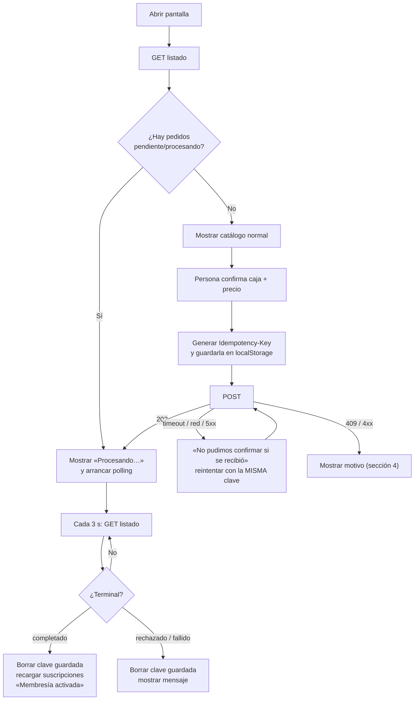

# Guía frontend: pedir una suscripción y seguir su estado

> **Resumen:** `POST` para pedir, `GET` en bucle (polling) hasta que el estado sea terminal. **No hay que construir ningún endpoint nuevo**: los tres ya existen. Todos requieren `Authorization: Bearer <accessToken>` y cuelgan de `/api`.

## 1. Endpoints

| Acción | Método y ruta | Cuándo se usa |
| --- | --- | --- |
| Crear pedido | `POST /api/solicitudes-suscripcion` | Al confirmar |
| **Consultar estado (polling)** | **`GET /api/solicitudes-suscripcion`** | Al abrir la pantalla y en bucle mientras haya pedidos abiertos |
| Consultar un pedido | `GET /api/solicitudes-suscripcion/:id` | Alternativa si solo querés seguir uno |

> Recomendado: pollear el **listado**. Sirve también para recuperar pedidos tras recargar, cerrar la pestaña o cambiar de dispositivo, y es lo que ya usa `CatalogoView.vue`.

### POST: crear

```http
POST /api/solicitudes-suscripcion
Authorization: Bearer <token>
Idempotency-Key: <uuid generado una vez por intención>
Content-Type: application/json

{ "cajaMensualId": "…", "precioConfirmadoCentavos": 1000 }
```

- Solo esos dos campos; cualquier otro devuelve `400`.
- `precioConfirmadoCentavos` es el precio que la persona vio y aceptó (10,00 → `1000`).
- Respuesta `202`:

```json
{ "status": "success",
  "data": { "id": "…", "cajaMensualId": "…", "estado": "pendiente",
            "suscripcionId": null, "createdAt": "…", "updatedAt": "…" } }
```

### GET: listado (el que se consulta en el polling)

```http
GET /api/solicitudes-suscripcion
→ 200 { "status": "success", "data": [ { id, cajaMensualId, estado, suscripcionId, createdAt, updatedAt }, … ] }
```

Devuelve solo los pedidos de la persona autenticada, del más nuevo al más viejo. `GET /:id` devuelve un único objeto igual (`404` si no es suyo).

### Respuesta casi instantánea: long-poll

`GET /api/solicitudes-suscripcion/:id?waitMs=4000` **retiene la respuesta hasta que el pedido sea terminal** (máx. 5000 ms) y vuelve en el momento en que el worker termina. Medido: **POST + resultado en ~95 ms**. Tras el `202`, llamarlo en bucle (máx. 3 veces); si no resolvió, seguir con el polling normal. Ya lo usa `CatalogoView.vue` (`followRequest`).

## 2. Estados y qué mostrar

| `estado` | Terminal | La UI muestra |
| --- | --- | --- |
| `pendiente`, `procesando` | No | «Procesando tu suscripción…» (botón deshabilitado) |
| `completado` | Sí | «Membresía activada». Recargar suscripciones reales (`suscripcionId` trae el id) |
| `rechazado` | Sí | «No pudimos activarla» y qué hacer |
| `fallido` | Sí | «No pudimos completarla, contactá a soporte» |

Nunca mostrar un pedido `pendiente`/`procesando` como membresía activa ni insertarlo en la lista de suscripciones.

## 3. Flujo completo



## 4. Respuestas de error del POST

| Respuesta | Significado | Qué hacer |
| --- | --- | --- |
| Timeout, sin red, `5xx`, `429` | No se sabe si se recibió | Reintentar con la **misma** clave y datos, o mirar el listado |
| `409` `PRICE_CHANGED` | El precio cambió | Descartar clave, recargar catálogo, pedir confirmar de nuevo |
| `409` `ALREADY_SUBSCRIBED` | Ya tiene suscripción viva a esa caja | Descartar clave, avisar |
| `409` `REQUEST_IN_PROGRESS` | Ya hay un pedido en curso para esa caja | Descartar clave, mostrar el pedido existente |
| `409` `IDEMPOTENCY_KEY_CONFLICT` | Misma clave con otros datos | No enviar otro; revisar el listado o soporte |
| `401` | Sesión vencida | El cliente HTTP renueva el token y reintenta; el reintento debe conservar la `Idempotency-Key` |
| `403` | Sin suscriptor vinculado / rol no permitido | Mensaje de acceso |
| `400` / `404` | Datos inválidos o caja no disponible | Mensaje y volver al catálogo |

Los `409` traen `{ "status": "error", "code": "…", "message": "…" }`.

## 5. Reglas del polling

| Regla | Valor sugerido |
| --- | --- |
| Frecuencia | el procesamiento tarda ~0,1–1 s: consultar cada 1 s los primeros 10 s, luego cada 3 s, y a 10 s pasados ~30 s |
| Cuándo arranca | al abrir la pantalla si hay pedidos abiertos, y al recibir el `202` |
| Cuándo se detiene | cuando ningún pedido está en `pendiente`/`procesando`, al salir de la vista o con la pestaña oculta (`document.hidden`) |
| Al volver a la pestaña | consultar de inmediato y retomar |
| Demora larga (> 2 min) | «Está demorando, sigue en curso» + botón «Actualizar». No declarar error: puede seguir en cola |
| Error al consultar | mostrar error con «Reintentar»; **no** asumir lista vacía ni habilitar un pedido nuevo |

## 6. La `Idempotency-Key`

- Se genera **una vez por intención** (`crypto.randomUUID()`) y se guarda **antes** de enviar, asociada al usuario.
- Cada reintento del mismo pedido usa la misma clave y el mismo cuerpo.
- Se borra cuando el pedido llega a un estado terminal o ante `PRICE_CHANGED`/`ALREADY_SUBSCRIBED`/`REQUEST_IN_PROGRESS`.
- Una nueva intención (otra caja u otro precio confirmado) usa una clave nueva.
- Al cerrar sesión o cambiar de usuario, no reutilizar claves de otra cuenta.

## 7. Qué ya está hecho en este repositorio

| Pieza | Archivo |
| --- | --- |
| Llamadas HTTP | `frontend/src/modules/suscripciones/services/solicitudes.service.ts` |
| Estado, clave y recuperación | `frontend/src/modules/suscripciones/store/solicitudes.store.ts` |
| Clasificación de errores | `frontend/src/modules/suscripciones/store/solicitudes.logic.ts` |
| Pantalla y polling | `frontend/src/views/CatalogoView.vue` |

Se activa con `VITE_SUBSCRIPTION_REQUESTS_ENABLED=true` (el backend, con `SUBSCRIPTION_REQUESTS_ENABLED=true` y el worker corriendo; ver [runbook](runbook-colas-suscripciones.md)).

## 8. Límites actuales (no hace falta construir nada para empezar)

- **Sin motivo del rechazo:** el API no devuelve un texto del motivo. Para `rechazado` y `fallido` la UI usa mensajes genéricos. Si se quiere mostrar la causa (p. ej. «caja ya no disponible»), habría que agregar un campo de motivo público en el backend.
- **Sin push:** el estado solo se obtiene consultando. Si algún día se quiere avisar con la app cerrada, sería un email o notificación enviada por el worker; no cambia este contrato.
- El header `Location` del `202` existe, pero el cliente HTTP actual solo expone el cuerpo; alcanza con el `id` del cuerpo.
