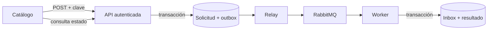

# Colas para pedidos de suscripción

Esta implementación prepara un pedido de suscripción durable y procesado en segundo plano con RabbitMQ. **La activación está deshabilitada por defecto y todavía faltan pruebas con RabbitMQ y PostgreSQL reales.** La API, el worker y el frontend tienen flags independientes: habilitar la API no comprueba que el worker esté funcionando.

## Flujo principal

1. En el catálogo, el usuario confirma la caja y el precio. El navegador guarda una clave por intención para poder repetir el mismo envío si desconoce su resultado.
2. La API autentica al usuario, comprueba su vínculo con el suscriptor y delega el pedido. El caso de uso valida caja, tenant y precio del servidor; en una transacción guarda la solicitud y un mensaje outbox. Responde `202` con el ID y `Location` después del commit.
3. El relay reclama el mensaje, lo publica con ID estable y marca su publicación solamente tras la confirmación del broker. Si cae antes de marcarlo, puede publicarlo otra vez.
4. El consumidor valida el mensaje y, en una transacción, registra el inbox, aplica la regla de suscripción y actualiza el estado del pedido. La confirmación al broker sucede después del resultado durable.
5. El frontend consulta el estado; una solicitud pendiente no se muestra como membresía activa. Ante una respuesta incierta conserva la clave y el payload para reintentar.

### Garantías y límites

- La unicidad de la clave es por **principal y clave**. Misma clave y payload devuelve el pedido existente; una carga distinta responde `409` con `IDEMPOTENCY_KEY_CONFLICT`. Un precio distinto al vigente en la primera aceptación responde `PRICE_CHANGED`.
- El broker puede recibir o entregar duplicados. La transacción e inbox protegen el efecto de negocio por pedido; no se promete publicación física única ni exactly-once distribuido.
- El precio confirmado queda como snapshot. El worker vuelve a comprobar identidad, vínculo, tenant, disponibilidad y duplicados de negocio antes de crear la suscripción.
- Hay reintentos y reconciliación de publicaciones vencidas; los mensajes rechazados se derivan a DLQ. La recuperación operativa y los casos de falla deben probarse con infraestructura real antes de activar.
- El puerto no expone RabbitMQ al caso de uso. SQS y Pub/Sub son posibles adaptadores futuros: no están implementados ni se afirma que compartan todas sus semánticas.

## Flags y activación

| Control | Efecto actual |
| --- | --- |
| `SUBSCRIPTION_REQUESTS_ENABLED=true` | Monta la API nueva en el backend. |
| `QUEUE_RUNTIME_ENABLED=true` | Permite iniciar el proceso worker/relay. |
| `VITE_SUBSCRIPTION_REQUESTS_ENABLED=true` | Activa el flujo nuevo en el frontend. |

Son controles separados. **No habilitar solo la API:** podría aceptar pedidos sin un proceso que los consuma. Antes de activarlos, completar [el checklist de cierre](pendientes-cierre-colas-suscripciones.md), desplegar y verificar el worker y relay, y después coordinar API y frontend. Para configuración, monitoreo, replay y drenaje, consultar el [runbook operativo](runbook-colas-suscripciones.md).

## Archivos por capa

### Contratos y transporte

| Archivo | Función |
| --- | --- |
| `Backend/src/common/messaging/message-transport.ts` | Sobre y contrato de publicación, consumo y cierre. |
| `Backend/src/common/messaging/rabbitmq-transport.ts` | Topología RabbitMQ, publicación confirmada y enrutada, consumo, ack y DLQ. |
| `Backend/src/common/messaging/rabbitmq-factory.ts` | Creación de conexiones y reconexión limitada. |
| `Backend/src/common/messaging/queue-config.ts` | Valida URL, topología, reintentos de conexión y polling. |
| `Backend/src/modules/solicitudes-suscripcion/infrastructure/queue-runtime.ts` | Ciclo de vida del consumidor, relay y scheduler de reconciliación; controlado por flag. `Backend/src/workers/queue-worker.ts` es solo el punto de entrada. |
| `Backend/src/workers/queue-admin.ts` | Punto de entrada para estadísticas y replay administrativo. |

### Pedidos, persistencia y seguridad

| Archivo | Función |
| --- | --- |
| `Backend/src/modules/solicitudes-suscripcion/domain/aceptar-solicitud.ts` | Validación, idempotencia y persistencia atómica de pedido/outbox. |
| `Backend/src/modules/solicitudes-suscripcion/domain/procesar-solicitud.ts` | Validación del mensaje y creación idempotente de la suscripción. |
| `Backend/src/modules/solicitudes-suscripcion/domain/sqlite-serialization.ts` | Coordina operaciones que comparten la conexión SQLite de un DataSource. |
| `Backend/src/modules/solicitudes-suscripcion/infrastructure/solicitud.entity.ts` | Estado, identidad, clave y snapshot del pedido. |
| `Backend/src/modules/solicitudes-suscripcion/infrastructure/outbox.entity.ts` | Mensaje pendiente/publicado, claim y tiempo de publicación. |
| `Backend/src/modules/solicitudes-suscripcion/infrastructure/inbox.entity.ts` | Registro de mensajes procesados. |
| `Backend/src/modules/solicitudes-suscripcion/infrastructure/outbox-relay.ts` | Reclama y publica, conserva ID y aplica espera tras fallos. |
| `Backend/src/modules/solicitudes-suscripcion/infrastructure/retry-reconciler.ts` | Reprograma o agota entregas y recupera publicaciones vencidas. |
| `Backend/src/modules/solicitudes-suscripcion/infrastructure/queue-ops.ts` | Estadísticas y replay de pedidos fallidos. |
| `Backend/src/modules/solicitudes-suscripcion/presentation/solicitudes-router.ts` | Crear y consultar solicitudes propias; autenticación y códigos de conflicto. |
| `Backend/src/modules/auth/infrastructure/user.entity.ts` | Vínculo explícito entre usuario y suscriptor. |
| `Backend/src/modules/auth/domain/useCase/register-subscriptor.ts` | Registro transaccional y creación del vínculo; no adopta registros existentes por email. |
| `Backend/src/modules/suscripciones/domain/useCase/create-suscripcion.ts` | Evita una suscripción activa o pausada duplicada en el flujo anterior. |
| `Backend/src/modules/suscripciones/presentation/suscripciones-router.ts` | Controles de autenticación y alcance para rutas de suscripciones. |
| `Backend/src/common/patterns/factory/entities.ts` | Registro TypeORM de las entidades nuevas. |
| `Backend/src/app.ts` | Montaje condicional de la API de pedidos. |

### Esquema y configuración

| Archivo | Función |
| --- | --- |
| `Backend/src/migrations/1796000000000-LinkUsersToSuscriptores.ts` | Columna, vínculo único y clave foránea de identidad; no enlaza cuentas históricas automáticamente. |
| `Backend/src/migrations/1797000000000-AddSubscriptionRequests.ts` | Tablas e índices de solicitud, outbox e inbox. |
| `Backend/src/migrations/1798000000000-UniqueLiveSubscription.ts` | Restricción de unicidad para suscripciones vigentes. |
| `Backend/.env.example` | Variables de ejemplo y controles de activación. |
| `Backend/package.json`, `Backend/package-lock.json` | Dependencias y scripts del backend, worker y herramientas. |
| `docker-compose.yml` | Servicio local de RabbitMQ y almacenamiento. |

Las migraciones nuevas no fueron aplicadas a una base persistente en esta sesión. Si una versión anterior de `179700` ya se aplicó en otro entorno, crear una migración incremental; no reescribir su historial. Probar primero con copias aisladas y sincronización automática desactivada.

### Frontend

| Archivo | Función |
| --- | --- |
| `frontend/src/views/CatalogoView.vue` | Confirmación accesible, estados, polling y recuperación desde el catálogo. |
| `frontend/src/modules/suscripciones/services/solicitudes.service.ts` | Llamadas tipadas a la API y cabecera de idempotencia. |
| `frontend/src/modules/suscripciones/store/solicitudes.store.ts` | Conserva intento y estado por usuario y coordina consultas y envíos. |
| `frontend/src/modules/suscripciones/store/solicitudes.logic.ts` | Lógica de clasificación y tratamiento de respuestas. |
| `frontend/package.json` | Script de pruebas del frontend. |

## Pruebas y pendientes de activación

| Archivo | Cobertura principal |
| --- | --- |
| `Backend/test/identity-link.test.cjs` | Registro y vínculo de identidad. |
| `Backend/test/legacy-subscriptions-api.test.cjs` | Autorización del flujo anterior. |
| `Backend/test/migrations.test.cjs` | Migraciones. |
| `Backend/test/subscription-requests.test.cjs` | Aceptación, idempotencia y rollback. |
| `Backend/test/subscription-requests-api.test.cjs` | API, propiedad y conflictos. |
| `Backend/test/outbox-relay.test.cjs` | Reclamos, publicación y recuperación del relay. |
| `Backend/test/process-subscription-request.test.cjs` | Procesamiento y duplicados. |
| `Backend/test/retry-reconciler.test.cjs` | Reintentos y reconciliación. |
| `Backend/test/queue-ops-and-uniqueness.test.cjs` | Operaciones administrativas y unicidad. |
| `Backend/test/queue-runtime.test.cjs` | Configuración y lifecycle del scheduler. |
| `Backend/test/messaging/rabbitmq-transport.test.cjs` | Adaptador y transporte con dobles. |
| `frontend/test/solicitudes-logic.test.mjs` | Lógica del flujo de solicitudes. |

- [ ] Ejecutar `npm test` y `npm run build` en `Backend` y `frontend` sobre el estado final; registrar resultados.
- [ ] Probar RabbitMQ real: enrutamiento, confirmaciones, duplicados, reinicio, DLQ y recuperación. Los dobles no prueban el broker.
- [ ] Probar migraciones y concurrencia en PostgreSQL real y SQLite aislados; validar también seguridad y aislamiento entre tenants.
- [ ] Probar extremo a extremo y en navegador: timeout con respuesta perdida, reintento, conflicto, cambio de usuario, accesibilidad y estado final.
- [ ] Definir y verificar observabilidad, operación, vínculo de cuentas existentes, despliegue gradual y rollback con drenaje. Mantener flags apagados hasta completar estas pruebas.

El [plan original](plan-colas-suscripciones.md) contiene el alcance y los escenarios previstos; el [checklist de cierre](pendientes-cierre-colas-suscripciones.md) concentra los pendientes vigentes.
