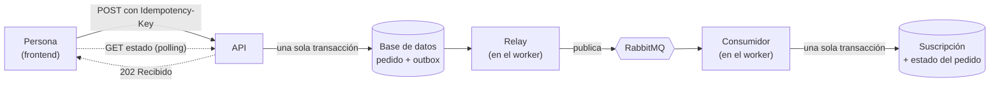
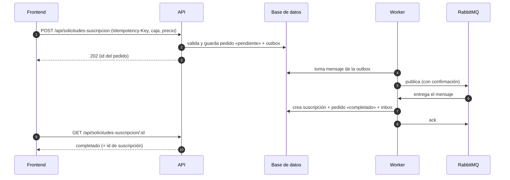
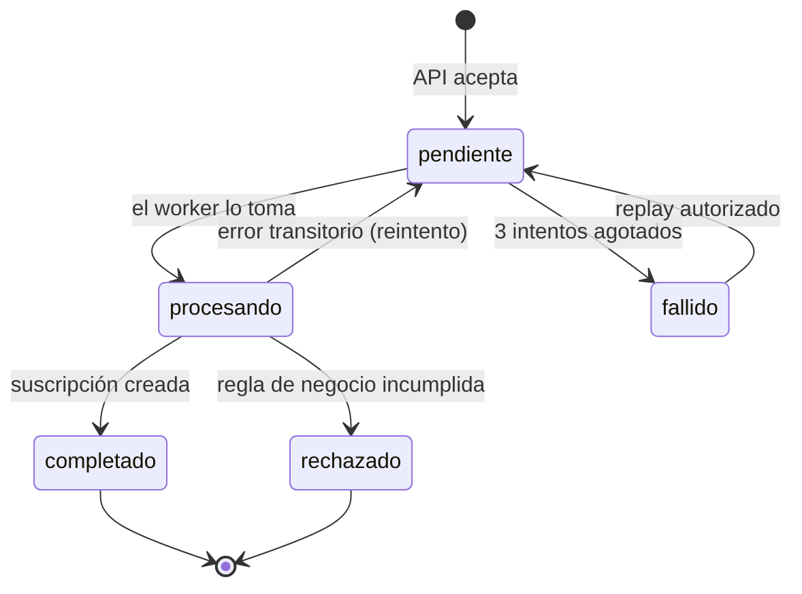
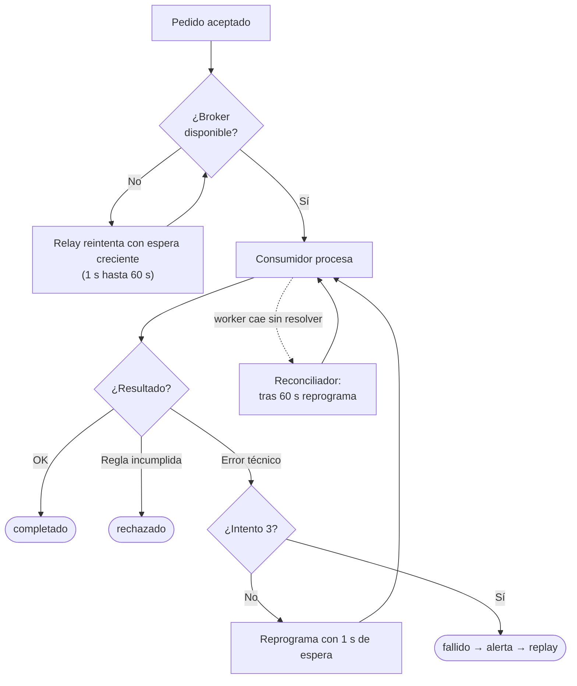
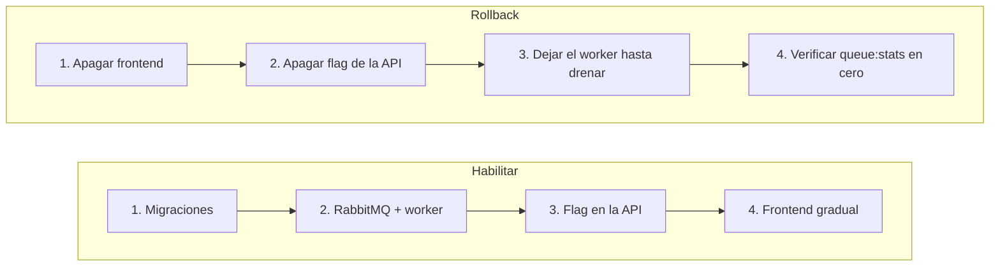
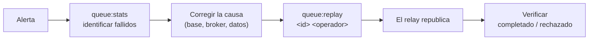

# Pedidos de suscripción con colas: cómo funciona y cómo operarlo

> **En una frase:** pedir una suscripción ya no la crea al instante. La API **anota el pedido de forma durable** y responde «recibido»; un **worker** lo procesa en segundo plano y recién entonces existe la suscripción.

## 1. Visión general



Tres piezas, dos procesos:

| Pieza | Dónde corre | Qué hace |
| --- | --- | --- |
| **API** | `npm start` | Valida, guarda pedido + mensaje (*outbox*) y responde `202`. Nunca crea la suscripción. |
| **Relay** | worker | Toma mensajes pendientes de la outbox y los publica en RabbitMQ con confirmación. |
| **Consumidor** | worker | Recibe el mensaje, vuelve a validar y crea la suscripción. |
| **Reconciliador** | worker | Recupera pedidos cuyo mensaje se publicó pero nunca se resolvió (pasados 60 s). |

**Garantía:** el pedido aceptado nunca se pierde y produce **como máximo una suscripción**. El mensaje puede entregarse más de una vez; el efecto de negocio no se repite (tabla *inbox* + estado del pedido).

## 2. Camino de un pedido



Si el worker está apagado el paso 3 igual ocurre: el pedido queda `pendiente` y se procesa solo cuando el worker vuelve. La interfaz lo muestra como «procesando», nunca como membresía activa.

## 3. Estados de un pedido



| Estado | Significado | ¿Terminal? |
| --- | --- | --- |
| `pendiente` | Guardado, esperando publicación o procesamiento | No |
| `procesando` | Un worker lo está tratando | No |
| `completado` | Suscripción creada | Sí |
| `rechazado` | Regla de negocio: usuario inactivo, caja no disponible, suscripción viva duplicada… | Sí |
| `fallido` | Agotó los reintentos por errores técnicos | Solo con replay |

Son independientes de `activa`/`pausada`/`cancelada`, que describen la **suscripción** ya creada.

## 4. Reglas de negocio vigentes

| Tema | Regla implementada |
| --- | --- |
| **Quién puede pedir** | Solo rol `subscriptor` con suscriptor vinculado y activo (`users.suscriptorId`; nunca se infiere por email). Los administradores usan el CRUD administrativo. |
| **Duplicados** | Una suscripción viva (`activa`/`pausada`) por suscriptor y caja, sin importar la clave. Respuestas: `409 ALREADY_SUBSCRIBED` o `409 REQUEST_IN_PROGRESS`. El worker re-valida y el índice `uq_suscripcion_viva` lo garantiza en la base. |
| **Idempotencia** | Misma clave + mismo contenido → devuelve el mismo pedido. Misma clave + otro contenido → `409 IDEMPOTENCY_KEY_CONFLICT`. |
| **Precio** | El cliente confirma el precio en centavos. Si cambió al aceptar → `409 PRICE_CHANGED`. El monto de la suscripción es el confirmado. |
| **Tenant** | Se toma de la caja, nunca del cliente. |
| **Convivencia** | `POST /api/suscripciones` sigue vigente (autenticado, aislado por tenant, precio y tenant tomados de la caja). |
| **Retención** | No se borra nada automáticamente (decisión de purga pendiente del equipo). |

## 5. Qué pasa cuando algo falla



| Falla | Resultado |
| --- | --- |
| Worker apagado | El pedido espera `pendiente`; se procesa al volver. |
| Broker caído | Se acepta igual; el worker reintenta la conexión y publica al volver. |
| Worker muere a mitad (`kill -9`) | Se reentrega; no hay duplicados. |
| Mensaje inválido o agotado | Va a la cola de mensajes muertos (`subscription.requests.dlq`). |
| Error persistente | Tras 3 intentos queda `fallido` (espera 1 s entre intentos). |

## 6. Procesos y flags

Todos están **apagados por defecto**.

| Proceso | Comando | Flag |
| --- | --- | --- |
| API | `npm start` | `SUBSCRIPTION_REQUESTS_ENABLED=true` monta `/api/solicitudes-suscripcion` |
| Worker | `npm run worker` (desarrollo, sin build) · `npm run build && npm run worker:prod` (producción) | `QUEUE_RUNTIME_ENABLED=true` |
| Frontend | build | `VITE_SUBSCRIPTION_REQUESTS_ENABLED=true` |

Variables en `Backend/.env.example`: `RABBITMQ_*`, `OUTBOX_POLL_INTERVAL_MS` (50 ms por defecto; menos latencia vs. más consultas en reposo), `OUTBOX_BATCH_SIZE` (50) y `RABBITMQ_PREFETCH` (20, mensajes en paralelo por worker). Medido en local (PostgreSQL + RabbitMQ, 1 worker): 300 pedidos procesados en ~1 s y ~95 ms de punta a punta (POST + long-poll `GET /:id?waitMs=`); `node scripts/load-test.cjs 300 1` repite la prueba (crea y borra su propia base). Nunca registrar `RABBITMQ_URL` completa.

**Supervisión:** correr el worker bajo un supervisor que lo reinicie si sale con error (systemd, Docker `restart: unless-stopped`, PM2). Ante `SIGTERM`/`SIGINT` deja de programar, termina el ciclo en curso y cierra broker y base.

## 7. Habilitar y deshacer



**Habilitar**
1. `npm run migration:run` (incluye `1799` con índices de rendimiento). Revisar antes el historial del entorno: si `1797…` ya corrió, no editarla. La `1798…` falla con mensaje claro si hay duplicados vivos (resolverlos primero).
   > La API ya no ejecuta migraciones al arrancar: con `DB_SYNCHRONIZE=false` hay que correr siempre `npm run migration:run`. La cadena completa (`1793…` a `1799100…`) se probó sobre un PostgreSQL vacío. Las migraciones `1793…`/`1794100…` (rama de auth/multitenancy) son solo de PostgreSQL; con SQLite se usa `DB_SYNCHRONIZE=true`.
2. Levantar RabbitMQ y el worker con `QUEUE_RUNTIME_ENABLED=true`; revisar `npm run queue:stats`.
3. Activar `SUBSCRIPTION_REQUESTS_ENABLED=true` y verificar `/api/health`.
4. Construir el frontend con el flag y desplegar gradualmente.

**Rollback:** el worker sigue corriendo hasta que `queue:stats` muestre `pendiente: 0`, `outboxPending: 0` y sin `procesando`. No borrar tablas; `1797…` se niega a revertirse si hay registros.

## 8. Monitoreo

`npm run queue:stats` imprime solo conteos y edades (sin cargas ni identidades). Programarlo con cron y alertar:

| Señal | Umbral sugerido | Qué indica |
| --- | --- | --- |
| `oldestPendingOutboxAgeMs` | > 60 000 ms | Publicación bloqueada o broker caído |
| `oldestUnconfirmedPublishedAgeMs` | > 300 000 ms | Consumo detenido |
| `requestsByState.fallido` | > 0 | Hay pedidos que revisar |
| `requestsByState.procesando` | sin cambios > 5 min | Procesamiento trabado |
| Mensajes en `subscription.requests.dlq` | cualquiera | Revisar en la consola de RabbitMQ (puerto 15672) |

## 9. Investigar y reencolar un pedido fallido



```bash
npm run queue:stats
```
```bash
npm run queue:replay -- <requestId> <operador>
```

- Solo se reencolan pedidos `fallido`, de a uno (no hay replay masivo).
- Conserva la identidad del pedido y deja una línea de auditoría `request.replayed` con el operador y la hora.
- El efecto es idempotente: reprocesar no duplica suscripciones.
- Solo lo ejecutan operadores con acceso al servidor.
